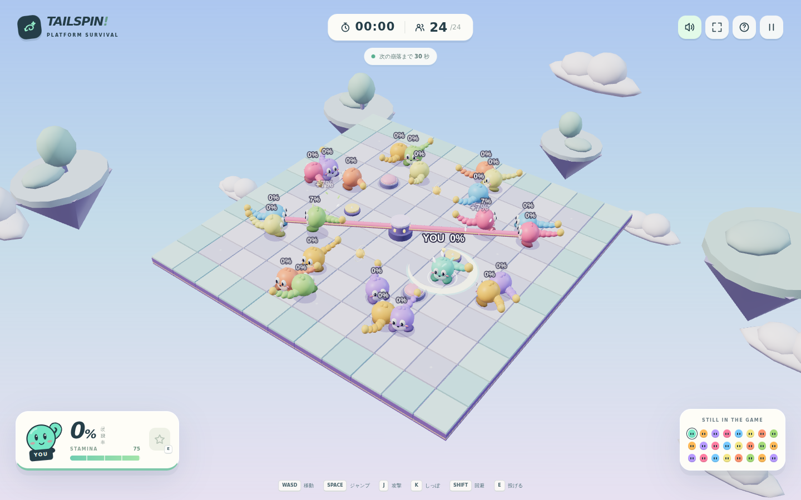

# TAILSPIN!

**しっぽで、最後のひとりに。**

丸い体、ふたつの足、よく動くしっぽ。空に浮かぶアリーナで、相手を吹っ飛ばして最後まで生き残る3Dサバイバルアクションです。

**[ブラウザーで遊ぶ →](https://ks250206.github.io/platform-survival/)**



標準設定は **プレイヤー1人＋CPU23体、合計24体の同時対戦**。8体・16体にも切り替えられます。現在は1台のブラウザーで動くローカルCPU戦で、オンライン対戦・通信機能はありません。

## 遊び方

1. カラー、対戦人数、CPUの強さを選び、**バトルスタート**。
2. 攻撃で相手の吹っ飛び率をため、しっぽスピンで場外へ。
3. 中央の回転棒はジャンプやローリングで回避。光り始めた外周の床からは早めに退避。
4. スターを拾って投げたり、飛んでくるスターをしっぽで打ち返したりして、最後の1体を目指します。

ダメージはHPではなく、吹っ飛びやすさを表す％です。低い％でも足場から落ちれば脱落し、高い％でも足場に残っていれば戦えます。脱落後はCPU同士の戦いを観戦するか、すぐに再挑戦できます。

### キーボード

| 操作            | キー              | 内容                                     |
| --------------- | ----------------- | ---------------------------------------- |
| 移動            | `WASD` / 方向キー | 画面上の方向に移動。移動した方向を向く   |
| ジャンプ        | `Space`           | 地上でのみ使用。空中ジャンプなし         |
| 弱攻撃          | `J`               | 前方への素早い攻撃。空中では空中攻撃     |
| しっぽスピン    | `K`               | 周囲を弾く強攻撃。空中では空中攻撃       |
| ローリング回避  | `Shift`           | 地上でのみ使用。短い無敵時間と終了後の隙 |
| スターを投げる  | `E`               | 拾ったスターを向いている方向へ投げる     |
| 一時停止 / 再開 | `Esc`             | 試合とカウントダウンを停止・再開         |
| やり直す        | `R`               | 試合中・結果画面から再挑戦               |

### タッチ・ゲームパッド

タッチ端末では、左の仮想スティックで移動し、右の「攻撃」「しっぽ」「ジャンプ」「回避」「投げる」を使います。画面の縦横どちらにも対応しています。

ゲームパッドはブラウザーのGamepad APIを使用します。最初に画面上のバトルスタートを押してください。以下は標準配列の対応で、コントローラーやブラウザーによって印字・認識が異なる場合があります。

| 操作                    | Xbox表記                | PlayStation表記         |
| ----------------------- | ----------------------- | ----------------------- |
| 移動                    | 左スティック / 十字キー | 左スティック / 十字キー |
| ジャンプ                | A                       | ×                       |
| ローリング              | B                       | ○                       |
| 弱攻撃 / 空中攻撃       | X                       | □                       |
| しっぽスピン / 空中攻撃 | Y                       | △                       |
| スターを投げる          | RB                      | R1                      |
| 一時停止                | Menu / Start            | Options                 |

操作の実装は [`src/game/input.ts`](src/game/input.ts) にまとめています。

## 実装したルール

| 要素         | 仕様                                                                                            |
| ------------ | ----------------------------------------------------------------------------------------------- |
| キャラクター | 球状の体、足、目、曲がったしっぽ。歩行・ジャンプ・ローリング・攻撃のアニメーション              |
| カメラ       | 斜め上からアリーナを見渡す3D透視投影。移動方向はカメラに合わせて変換                            |
| 参加人数     | 標準24体。人間1人、残りはCPU。UIで8 / 16 / 24体を選択                                           |
| 勝敗         | 落下で脱落、最後の1体が勝利。同時に全員が脱落した場合は引き分け                                 |
| 吹っ飛び率   | 0〜999%。攻撃・ギミックに被弾すると増加し、ノックバック速度が上がる                             |
| スタミナ     | 最大100。強攻撃25、空中攻撃10、ローリング28を消費。待つと回復                                   |
| しっぽスピン | 発生までの予備動作、周囲への判定、終了後の隙。1回の攻撃で同じ相手に重複ヒットしない             |
| 打ち返し     | スピンの攻撃判定中にスターを反射。所有者・色が変わり、速度と威力が上がる                        |
| ギミック     | 徐々に加速する回転棒、バンパー2基、ジャンプ床2枚、スターの出現地点2か所、外周からの飛来スター   |
| 外周崩落     | 11×11の床。試合開始30秒後に最初の外周が崩れ、以降25秒ごとに内側へ。毎回5秒前に予告              |
| CPU          | 近くの相手と交戦し、外周・障害物を回避。ジャンプ、回避、強攻撃、アイテム使用を選択。3段階の強さ |
| 音・画面     | Web Audioによる合成効果音、ミュート、対応ブラウザーでの全画面表示。別タブへ移ると自動停止       |

数値・判定・設計上の制約は [ゲーム設計メモ](docs/design.md) に記載しています。

## 開発環境

[`package.json`](package.json) とロックファイルで次の構成を固定しています。

| ツール / ライブラリ | バージョン                                   | 役割                                          |
| ------------------- | -------------------------------------------- | --------------------------------------------- |
| Node.js             | 26.13.1                                      | 実行環境。`.nvmrc` / `.node-version` にも指定 |
| pnpm                | 12.21.0                                      | パッケージ管理                                |
| Vite Plus           | 1.6.0                                        | 開発サーバー、ビルド、テスト、整形・lint      |
| Vite                | `@voidzero-dev/vite-plus-core@1.6.0` のalias | Vite Plusと統一したビルド基盤                 |
| React / React DOM   | 19.3.1                                       | ロビー、HUD、操作・結果画面                   |
| Tailwind CSS        | 4.3.5                                        | UIスタイル基盤                                |
| PixiJS              | 8.23.0                                       | 描画アプリケーション、2Dラベルとエフェクト    |
| PixiJS 3D           | `@pixi/3d@0.1.0`                             | 実際の3Dメッシュ・カメラ・ライティング        |
| TypeScript          | 7.0.2                                        | ゲーム状態・入力・描画間の型定義              |
| Playwright          | 1.65.1                                       | ブラウザー確認                                |

3D部分はPixiJS公式の [`@pixi/3d`](https://pixijs.com/3d/guides/getting-started/installation) を使用しています。旧来の別パッケージ `pixi3d` とは異なります。

### 起動

Node.js 26.13.1を用意してから実行します。nvmを使用している場合は、リポジトリ直下で `nvm install` / `nvm use` を実行できます。

```sh
npm install -g pnpm@12.21.0
pnpm install --frozen-lockfile
pnpm dev
```

開発URL: <http://localhost:5173/platform-survival/>

### コマンド

| コマンド                 | 内容                                           |
| ------------------------ | ---------------------------------------------- |
| `pnpm dev`               | 開発サーバー                                   |
| `pnpm typecheck`         | TypeScriptの型チェック                         |
| `pnpm test`              | 描画から独立したシミュレーションテスト         |
| `pnpm build`             | 型チェック後に本番ビルド。出力先は `dist/`     |
| `pnpm preview`           | 本番ビルドをローカルで表示                     |
| `pnpm test:e2e`          | Playwrightで本番ビルドを確認。先にビルドが必要 |
| `pnpm check`             | 型チェック → シミュレーションテスト → ビルド   |
| `pnpm lint` / `pnpm fmt` | lint / コード整形                              |

ブラウザーテストの初回は Chromium をインストールします。LinuxでOS依存パッケージも必要な場合は `--with-deps` を付けます。

```sh
pnpm exec playwright install chromium
pnpm build
pnpm test:e2e
```

本番プレビューURL: <http://localhost:4173/platform-survival/>

## ファイル構成

| ファイル                                                                      | 内容                                                   |
| ----------------------------------------------------------------------------- | ------------------------------------------------------ |
| [`src/App.tsx`](src/App.tsx)                                                  | 固定刻みのゲームループ、入力・音・描画・Reactの接続    |
| [`src/game/types.ts`](src/game/types.ts)                                      | 共通型、24体の初期設定、アリーナ寸法                   |
| [`src/game/engine.ts`](src/game/engine.ts)                                    | 移動、CPU、戦闘、アイテム、崩落、勝敗                  |
| [`src/game/combat.ts`](src/game/combat.ts)                                    | 技ごとのダメージ・判定時間・コスト、ノックバック式     |
| [`src/game/renderer.ts`](src/game/renderer.ts)                                | PixiJS 3Dのシーン、カメラ、ラベル、エフェクト          |
| [`src/game/meshes.ts`](src/game/meshes.ts)                                    | キャラクター・しっぽ・アリーナのプロシージャルメッシュ |
| [`src/game/input.ts`](src/game/input.ts)                                      | キーボード・タッチ・ゲームパッド入力の統一             |
| [`src/game/audio.ts`](src/game/audio.ts)                                      | 外部音源不要の効果音                                   |
| [`src/ui/GameUI.tsx`](src/ui/GameUI.tsx) / [`src/styles.css`](src/styles.css) | ロビー、HUD、各種メニュー、レスポンシブUI              |
| [`tests/engine.test.ts`](tests/engine.test.ts)                                | 戦闘、反射、崩落、勝敗、再現性のテスト                 |
| [`.github/workflows/pages.yml`](.github/workflows/pages.yml)                  | 検証とGitHub Pagesへのデプロイ                         |

## GitHub Pages

公開先は <https://ks250206.github.io/platform-survival/> です。Viteの `base` は `/platform-survival/` に設定しています。

リポジトリの **Settings → Pages → Build and deployment → Source** を **GitHub Actions** に設定します。`main` へのpushで、依存関係の固定インストール、型チェック、シミュレーションテスト、本番ビルド、ブラウザー確認を順に実行し、成功したビルドを公開します。Pull requestでは検証のみを行います。Actions画面からの手動実行にも対応しています。

公開設定・検証手順の定義は [`pages.yml`](.github/workflows/pages.yml) にあります。別のリポジトリ名で公開する場合は [`vite.config.ts`](vite.config.ts) の `base` とPlaywrightのURLを合わせて変更してください。

## 動作条件と現在の範囲

- WebGL 2に対応したブラウザーが必要です。描画できない場合はハードウェアアクセラレーションの設定を確認してください。
- 24体のCPU戦を想定して、メッシュ・マテリアルの共有、簡易影、描画解像度の上限を設けています。実際のフレームレートは端末に依存します。
- ネットワーク対戦、複数人でのローカル操作、キャラクター別の性能差、試合の保存・ランキングは未実装です。
- バランス調整中のプロトタイプです。技の数値は `combat.ts`、ギミックやCPUの挙動は `engine.ts` から変更できます。

## アセットとライセンス

キャラクター、アリーナ、雲、UIのマスコットはコードで生成したオリジナルの形状です。効果音はWeb Audioで合成しています。カービィ・パックマンなど既存作品のモデル、画像、音源は使用していません。

本リポジトリは既存の [MIT License](LICENSE) を維持しています。各依存ライブラリには、それぞれのライセンスが適用されます。
